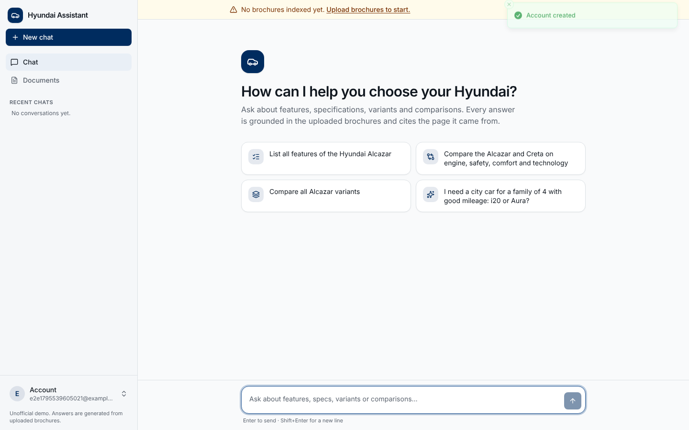

# Hyundai Assistant: RAG automotive consultant

An AI automotive consultant that answers questions about Hyundai cars **only from the brochures you
upload**, with page-level citations. Sign in, upload official Hyundai PDF brochures, and ask for feature
lists, cross-model and variant comparisons (as Markdown tables), or a recommendation for your needs.
When the brochures don't cover something, it says so instead of guessing.



| | |
|---|---|
| **Live demo** | https://hyundai-assistant.onrender.com (API: https://hyundai-assistant-api.onrender.com/api/health) |
| **Demo login** | `demo@hyundai-assistant.app` / `Demo1234` (or create your own account) |
| **Demo video** | _VIDEO_URL_ |

> **Cold start:** the backend runs on Render's free tier and sleeps after 15 minutes idle.
> The first request can take ~50 seconds; after that it is fast.

## Features (mapped to the task)

1. **Secure email/password login**: Argon2id hashing, JWT in an `httpOnly` `SameSite=Lax` cookie,
   rate-limited login/register, protected routes with redirect to `/login`.
2. **Brochure management**: drag-and-drop multi-file PDF upload straight to storage with a progress bar;
   table (cards on mobile) showing **document name, vehicle model, upload date, pages, chunks and
   processing status** (Queued → Processing with live progress → Ready/Failed), with view, rename,
   reprocess and delete, plus search and filters. Duplicate and non-PDF uploads are rejected.
3. **Automatic indexing**: PyMuPDF text and spec-table extraction (tables become Markdown), OCR fallback
   for image-only pages, section and variant tagging, table-aware chunking, Gemini embeddings in pgvector.
4. **AI consultant chat**: feature lists, model comparisons, variant comparisons and recommendations
   across engine, safety, comfort, technology and performance; Markdown comparison tables; inline `[n]`
   citations and source chips that open the PDF at the cited page; explicit
   *"Not specified in the uploaded brochures"* handling; streaming answers with stop, regenerate and copy;
   conversation history; light/dark mode; responsive down to 375 px.

## Tech stack

Next.js 15 (App Router, TypeScript strict, Tailwind CSS 4, shadcn/ui, TanStack Query, react-markdown +
remark-gfm) · FastAPI on Python 3.12 · SQLAlchemy 2 (async) + Alembic · PostgreSQL + pgvector
(Supabase) · Supabase Storage · Google Gemini (OpenAI switchable) · Render.

See **[docs/ARCHITECTURE.md](docs/ARCHITECTURE.md)** for the diagram and both pipelines, and
**[docs/DECISIONS.md](docs/DECISIONS.md)** for design decisions and deviations from the plan.

## How the RAG works

1. **Parse**: PyMuPDF reads every page's text blocks and detects spec tables, which are converted
   to Markdown. Pages without text are transcribed by the LLM's vision model.
2. **Clean and tag**: repeated headers and footers are removed (spec disclaimers such as "ARAI" are
   kept). Each block is tagged with a section (Specifications, Safety, …) and the variant names it mentions.
3. **Chunk**: ~500-token chunks with 80-token overlap, never crossing a page, so citations stay exact.
   Tables are never split mid-row; long tables repeat their header. Every chunk starts with
   `[Vehicle | Document | Page | Section]`.
4. **Embed**: Gemini `gemini-embedding-001` at 768 dimensions into `vector(768)` with an HNSW index.
5. **Understand**: one JSON-mode LLM call produces a query plan (intent, vehicles, variants, aspects,
   requirements, sub-queries). Follow-ups like "what about its safety?" resolve from history.
6. **Retrieve**: hybrid search (vector cosine + Postgres full-text) fused with Reciprocal Rank Fusion,
   run **per vehicle** so one brochure can't crowd out another in comparisons. Spec tables are always
   included for comparisons, and vehicles with no brochure are reported as missing.
7. **Generate**: a strict grounding prompt (only the numbered sources, cite every fact, "Not specified"
   for gaps, no outside prices) plus an intent-specific template, streamed over SSE.
8. **Cite**: only cited sources are saved and shown. If nothing was retrieved, the LLM is skipped and
   a fixed "couldn't find this in the uploaded brochures" message is returned.

## Local setup

Prerequisites: Docker (or a local PostgreSQL 16 with pgvector), Python 3.12, Node 22.

```bash
git clone https://github.com/gowem/AI-powered-Hyundai-Automotive-Assistant-.git
cd AI-powered-Hyundai-Automotive-Assistant-
docker compose up -d db
```

```bash
cd backend && python3.12 -m venv .venv && source .venv/bin/activate
pip install -r requirements-dev.txt && cp .env.example .env   # set GEMINI_API_KEY (or LLM_PROVIDER=fake)
alembic upgrade head && python scripts/create_user.py --email demo@hyundai-assistant.app --password Demo1234
uvicorn app.main:app --reload
```

```bash
# new terminal
cd frontend && npm install && cp .env.example .env.local && npm run dev
```

Open http://localhost:3000. With the default `STORAGE_BACKEND=local`, PDFs are stored in
`backend/uploads`, so no Supabase account is needed locally. `LLM_PROVIDER=fake` runs everything
offline with a deterministic stand-in model (useful for trying the UI; answers are not real).

## Environment variables

### Backend (`backend/.env`)

| Variable | Description | Default |
|---|---|---|
| `APP_ENV` | `development` / `production` / `test` | `development` |
| `DATABASE_URL` | `postgresql+asyncpg://…` (on Supabase use the **Session pooler**, port 5432) | local DB |
| `JWT_SECRET` | 64+ random characters | dev value |
| `JWT_EXPIRES_MINUTES` | session length | `720` |
| `COOKIE_SECURE` | `true` behind HTTPS | `false` |
| `COOKIE_NAME` | auth cookie name | `hyundai_session` |
| `FRONTEND_ORIGIN` | CORS origin(s), comma-separated | `http://localhost:3000` |
| `ALLOW_REGISTRATION` | allow sign-ups | `true` |
| `STORAGE_BACKEND` | `local` or `supabase` | `local` |
| `LOCAL_UPLOAD_DIR` | folder for local storage | `./uploads` |
| `SUPABASE_URL`, `SUPABASE_SERVICE_ROLE_KEY`, `SUPABASE_BUCKET` | Supabase Storage (backend only) | –, –, `brochures` |
| `MAX_UPLOAD_MB` | upload limit | `50` |
| `LLM_PROVIDER` | `gemini`, `openai` or `fake` | `gemini` |
| `GEMINI_API_KEY`, `GEMINI_CHAT_MODEL`, `GEMINI_EMBED_MODEL` | Gemini settings | –, `gemini-3.5-flash`, `gemini-embedding-001` |
| `OPENAI_API_KEY`, `OPENAI_CHAT_MODEL`, `OPENAI_EMBED_MODEL` | OpenAI alternative | –, `gpt-4o-mini`, `text-embedding-3-small` |
| `EMBEDDING_DIM` | fixed at 768 (reprocess documents after switching provider) | `768` |
| `VISION_OCR_FALLBACK` | OCR image-only pages with the LLM | `true` |
| `RETRIEVAL_TOP_K` | chunks for single-vehicle questions | `8` |

### Frontend (`frontend/.env.local`)

| Variable | Description |
|---|---|
| `BACKEND_URL` | backend base URL used by the `/api/*` rewrite (server-side) |
| `NEXT_PUBLIC_SUPABASE_URL`, `NEXT_PUBLIC_SUPABASE_ANON_KEY` | for direct-to-Supabase uploads (`STORAGE_BACKEND=supabase`) |
| `NEXT_PUBLIC_SHOW_DEMO_HINT`, `NEXT_PUBLIC_DEMO_EMAIL`, `NEXT_PUBLIC_DEMO_PASSWORD` | demo credentials hint on the login page |

## Deployment

1. **Supabase**: create a project (region Mumbai `ap-south-1`) and a **private** Storage bucket
   `brochures`. Copy the URL, the `anon` key (frontend), the `service_role` key (backend only) and the
   **Session pooler** connection string. The first migration enables `vector`.
2. **Render**: *New → Blueprint* on this repo uses [`render.yaml`](render.yaml), which defines both
   services. The backend runs `alembic upgrade head` before `uvicorn` and health-checks `/api/health`.
   Fill in the `sync: false` variables: `DATABASE_URL`, `SUPABASE_URL`, `SUPABASE_SERVICE_ROLE_KEY`,
   `GEMINI_API_KEY`, `FRONTEND_ORIGIN`; for the web service `BACKEND_URL` and the Supabase public values.
3. **Demo account**: `python scripts/create_user.py --email demo@hyundai-assistant.app --password …`
   against the production DB, or register through the UI.
4. **Upload the brochures** (Alcazar, Creta, i20, Aura, Venue, Verna, Exter from hyundai.com/in) on the
   Documents page.
5. **Vercel instead of Render for the frontend** works unchanged: import the repo with root directory
   `frontend` and the same environment variables.
6. During the review period, point a free uptime monitor (e.g. UptimeRobot) at `/api/health` every
   10 minutes so the free backend doesn't sleep.

## API reference

All endpoints are under `/api`. Everything except `auth/register`, `auth/login` and `health`
requires the session cookie. Interactive docs: `/api/docs`.

| Method | Path | Description |
|---|---|---|
| GET | `/health` | `{"status":"ok","db":true}` |
| POST | `/auth/register` | `{email, password, full_name?}` → 201 + cookie (409 duplicate, 403 disabled, 422 weak password) |
| POST | `/auth/login` | `{email, password}` → 200 + cookie, generic 401 |
| POST | `/auth/logout` | clears the cookie |
| GET | `/auth/me` | current user |
| GET | `/documents/vehicles` | known model names |
| POST | `/documents/upload-url` | `{filename, file_size_bytes, vehicle_model?, display_name?}` → signed upload |
| PUT | `/documents/{id}/upload?token=` | upload target in local storage mode |
| POST | `/documents/{id}/confirm` | verify PDF, dedupe by SHA-256, queue processing |
| GET | `/documents` | list with `q`, `vehicle_model`, `status`, `limit`, `offset` |
| GET | `/documents/{id}` | one document |
| GET | `/documents/{id}/view-url` | 10-minute signed PDF URL (append `#page=N`) |
| PATCH | `/documents/{id}` | rename / change model (owner only) |
| POST | `/documents/{id}/reprocess` | re-index (owner only) |
| DELETE | `/documents/{id}` | delete file, row and chunks (owner only) |
| GET / POST | `/chat/conversations` | list / create |
| GET / PATCH / DELETE | `/chat/conversations/{id}` | read with messages / rename / delete |
| POST | `/chat/conversations/{id}/messages` | `{content, regenerate?}` → SSE (`status`, `token`, `sources`, `done`, `error`); `?stream=false` returns JSON |

## Testing and evaluation

```bash
cd backend && pytest -q          # needs the hyundai_test database (created by docker compose)
ruff check . && ruff format --check .
cd ../frontend && npm run lint && npx tsc --noEmit && npm run build
```

The tests cover auth (including user isolation), the PDF parser and chunker (on synthetic PDFs generated
in the test), document upload, validation, deduplication, ownership and cascade delete, per-vehicle
retrieval balancing, and agent grounding (no-context short circuit, missing vehicles, citations, SSE).
CI runs all of this on every push ([`.github/workflows/ci.yml`](.github/workflows/ci.yml)).

Manual RAG evaluation: `python scripts/eval_rag.py --base-url … --email … --password … --out eval.md`
runs the 10 questions from the plan. Results are in **[docs/EVALUATION.md](docs/EVALUATION.md)**.

## Known limitations

- Brochures rarely contain prices, so price questions are answered with "not listed in the brochures".
- Brochure spec sheets are dense multi-panel layouts; some table rows merge several features into one
  cell. The model is instructed not to guess, but always check important numbers on the cited page.
- Image-only pages rely on the LLM's vision OCR (capped at 40 pages per document).
- Answer quality depends entirely on which brochures are uploaded and how current they are.
- Background processing runs in the web process; a restart re-queues unfinished documents.
- Free-tier hosting means cold starts and limited CPU for parsing large PDFs.

## Disclaimer

This is an unofficial project, not affiliated with or endorsed by Hyundai Motor Company or Hyundai Motor
India. Brochures and their contents belong to Hyundai Motor India Ltd. and are not included in this
repository.
